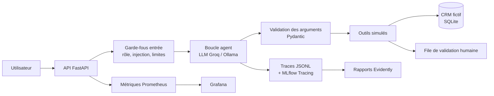

# SmartOps Agent

**Projet 3 : Agent intelligent : orchestration d'outils, observabilité et gouvernance**
Mini-projet MLOps, ENSAF ISDIA3, 2026-2027. Travail en binôme.

Un agent qui aide l'équipe d'une petite entreprise de services (Smartara, données fictives)
à chercher un client, vérifier une facture, calculer une commission ou préparer une relance.
L'agent lit et prépare. **Un humain valide toute action qui a un effet réel.**

## Architecture



## Démarrage rapide

Prérequis : Python 3.12, [uv](https://docs.astral.sh/uv/), Git, Docker (optionnel), Terraform (optionnel).
Sous Windows, utiliser WSL ou Git Bash pour `make`.

```bash
cp .env.example .env      # puis renseigner GROQ_API_KEY
make setup                # dépendances + hooks pre-commit
make ci                   # lint, types, tests, sécurité
make serve                # API sur http://localhost:8000/health
```

`make help` liste toutes les commandes.

## Chaîne MLOps

| Besoin (cahier des charges) | Outil |
|---|---|
| Code et revue | Git, GitHub, pull requests relues par le binôme |
| Qualité du code | ruff, mypy strict, pre-commit, commits conventionnels |
| Données et artefacts versionnés | DVC (données générées, résultats), Git (scénarios, configs) |
| Suivi des expériences | MLflow (paramètres, métriques, version du prompt et des données) |
| Tests | pytest : unitaires, intégration (LLM simulé), bout en bout, charge (Locust) |
| CI/CD | GitHub Actions : qualité, tests, sécurité, image Docker, eval gate, release |
| Quality gates | `configs/gates.yaml`, chaque seuil justifié |
| Sécurité | gitleaks, bandit, pip-audit, Trivy, Dependabot |
| Déploiement | Docker, Terraform (staging local), image publiée sur GHCR |
| Monitoring | Prometheus, Grafana, Evidently (dérive) |
| Gouvernance | registre des risques, fiche système, ADR, validation humaine |

## Structure du dépôt

```
configs/        agent, modèles, permissions, quality gates
src/            code de l'agent (api, agent, tools, guardrails, tracing, evaluation, monitoring)
tests/          unit, integration, e2e, load
data/           scénarios (Git) et base fictive générée (DVC)
reports/        résultats d'évaluation et de monitoring
monitoring/     Prometheus, Grafana, Evidently
infra/          Terraform
docker/         Dockerfile
docs/           cadrage, plan, spécifications, ADR, gouvernance, cahier des charges
```

## Documentation

- [Cadrage : les 7 questions du cahier des charges](docs/cadrage.md)
- [Plan du projet et répartition du binôme](docs/plan.md)
- [Spécification des outils](docs/specs/outils.md)
- [Décisions d'architecture (ADR)](docs/adr/)
- [Registre des risques](docs/gouvernance/registre-des-risques.md)
- [Fiche système](docs/gouvernance/fiche-systeme.md)
- [Dossier de reproductibilité](docs/reproductibilite.md)

## Avancement

- [x] Phase 0 : mise en place du projet
- [x] Phase 1 : cœur de l'agent
- [x] Phase 2 : évaluation et expériences
- [x] Phase 3 : observabilité
- [ ] Phase 4 : déploiement
- [ ] Phase 5 : livrables
