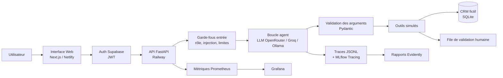

# SmartOps Agent

**Projet 3 : Agent intelligent : orchestration d'outils, observabilité et gouvernance**
Mini-projet MLOps, ENSAF ISDIA3, 2026-2027. Travail en binôme.

Un agent qui aide l'équipe d'une petite entreprise de services (Smartara, données fictives)
à chercher un client, vérifier une facture, calculer une commission ou préparer une relance.
L'agent lit et prépare. **Un humain valide toute action qui a un effet réel.**

## Architecture



## Démarrage rapide (5 minutes)

**Prérequis :** Python 3.12, [uv](https://docs.astral.sh/uv/), Git, Node.js 18+ (pour le frontend).
Docker et Terraform sont optionnels (stack complète). Sous Windows, utiliser WSL ou Git Bash pour `make`.

**Sans clé API**, tout fonctionne avec le LLM simulé intégré.

```bash
# 1. Copier la configuration (GROQ_API_KEY ou OPENROUTER_API_KEY optionnel)
cp .env.example .env

# 2. Installer les dépendances et les hooks
make setup

# 3. Vérifier que tout passe (lint, types, tests, sécurité, eval, gates)
make ci

# 4. Démarrer l'API backend
make serve
# --> http://localhost:8000/health  {"status": "ok", "version": "1.0.0"}
# --> http://localhost:8000/docs    interface Swagger

# 5. (Optionnel) Démarrer le frontend localement
cd frontend && npm install && npm run dev
# --> http://localhost:3000
```

**Version deployee publiquement :** backend sur Railway, frontend sur Netlify (authentification Supabase requise).

**Envoyer un message à l'agent (dev local, sans auth) :**

```bash
curl -s -X POST http://localhost:8000/chat \
  -H "Content-Type: application/json" \
  -d '{"message":"Cherche le client Bensaid Rim","role":"commercial","user_id":"alice","session_id":"demo-01"}' \
  | python -m json.tool
```

**Voir les résultats d'évaluation :** `reports/eval/metrics.json` (task_success=0.4933, commission_accuracy=1.0, p95_latency=3.45s production).
**Relancer l'évaluation :** `uv run python -m smartops_agent.evaluation.run --stub --repeats 1`

`make help` liste toutes les commandes disponibles.

## Chaîne MLOps

| Besoin (cahier des charges) | Outil |
|---|---|
| Code et revue | Git, GitHub, pull requests relues par le binôme |
| Qualité du code | ruff, mypy strict, pre-commit, commits conventionnels |
| Données et artefacts versionnés | DVC (données générées, résultats), Git (scénarios, configs) |
| Suivi des expériences | MLflow (paramètres, métriques, version du prompt et des données) |
| Tests | pytest : unitaires, intégration (LLM simulé), bout en bout, charge (Locust) |
| CI/CD | GitHub Actions : qualité, tests, sécurité, image Docker, eval gate, release |
| Quality gates | `configs/gates.yaml`, chaque seuil justifié |
| Sécurité | gitleaks, bandit, pip-audit, Trivy, Dependabot |
| Déploiement | Docker, Terraform (staging local), image publiée sur GHCR ; Railway (backend), Netlify (frontend) |
| Monitoring | Prometheus, Grafana, Evidently (dérive) |
| Gouvernance | registre des risques, fiche système, ADR, validation humaine |

## Structure du dépôt

```
configs/        agent, modèles, permissions, quality gates
src/            code de l'agent (api, agent, tools, guardrails, tracing, evaluation, monitoring)
tests/          unit, integration, e2e, load
data/           scénarios (Git) et base fictive générée (DVC)
reports/        résultats d'évaluation et de monitoring
monitoring/     Prometheus, Grafana, Evidently
infra/          Terraform
docker/         Dockerfile
docs/           cadrage, plan, spécifications, ADR, gouvernance, cahier des charges
```

## Documentation

- [Rapport de projet](docs/rapport/rapport.md)
- [Cadrage : les 7 questions du cahier des charges](docs/cadrage.md)
- [Plan du projet et répartition du binôme](docs/plan.md)
- [Évaluation : résultats et analyse](docs/evaluation.md)
- [Spécification des outils](docs/specs/outils.md)
- [Décisions d'architecture (ADR)](docs/adr/)
- [Registre des risques](docs/gouvernance/registre-des-risques.md)
- [Fiche système](docs/gouvernance/fiche-systeme.md)
- [Dossier de reproductibilité](docs/reproductibilite.md)
- [Script de démo (2 min)](docs/demo-script.md)

## Comprendre la repartition

Le projet est entierement fonctionnel. Voici les fichiers cles de chaque partie.

**JOHN Muhammed** -- boucle agent, API, deploiement :

- [src/smartops_agent/agent/loop.py](src/smartops_agent/agent/loop.py) -- boucle LLM, garde-fous, max 6 iterations
- [src/smartops_agent/api/app.py](src/smartops_agent/api/app.py) -- API FastAPI, routes `/chat` `/approvals` `/metrics`
- [src/smartops_agent/tools/](src/smartops_agent/tools/) -- 5 outils (search_crm avec entites client/lead/project/team_member, get_invoice_status, calculate_commission, draft_followup, request_human_action)
- [src/smartops_agent/guardrails/](src/smartops_agent/guardrails/) -- permissions par role, detection d'injection
- [src/smartops_agent/tracing/tracer.py](src/smartops_agent/tracing/tracer.py) -- traces JSONL avec masquage PII
- [src/smartops_agent/monitoring/metrics.py](src/smartops_agent/monitoring/metrics.py) -- 10 metriques Prometheus
- [docker-compose.yml](docker-compose.yml), [docker-compose.shadow.yml](docker-compose.shadow.yml), [docker-compose.canary.yml](docker-compose.canary.yml) -- deploiement shadow/canary

**Allah N'diguim Japhet** -- donnees, evaluation, observabilite, frontend :

- [src/smartops_agent/data/seed.py](src/smartops_agent/data/seed.py) -- generation de la base fictive (graine 42, 30 clients, 40 projets, 60 factures)
- [data/scenarios/](data/scenarios/) -- 75 scenarios JSONL en 7 categories
- [src/smartops_agent/evaluation/run.py](src/smartops_agent/evaluation/run.py) -- harnais d'evaluation (stub ou vrai LLM)
- [src/smartops_agent/evaluation/mlflow_client.py](src/smartops_agent/evaluation/mlflow_client.py) -- suivi MLflow des experiences
- [configs/gates.yaml](configs/gates.yaml) -- quality gates avec seuils justifies
- [monitoring/grafana/dashboards/smartops.json](monitoring/grafana/dashboards/smartops.json) -- tableau de bord (11 panneaux P50/P95/P99, actions risquees)
- [src/smartops_agent/monitoring/report.py](src/smartops_agent/monitoring/report.py) -- rapport de derive Evidently
- [tests/load/locustfile.py](tests/load/locustfile.py) -- test de charge Locust

**Ensemble :** [docs/gouvernance/](docs/gouvernance/), [docs/rapport/rapport.md](docs/rapport/rapport.md), [docs/adr/](docs/adr/), [CHANGELOG.md](CHANGELOG.md)

## Avancement

- [x] Phase 0 : mise en place du projet
- [x] Phase 1 : cœur de l'agent
- [x] Phase 2 : évaluation et expériences
- [x] Phase 3 : observabilité
- [x] Phase 4 : déploiement
- [x] Phase 5 : livrables
